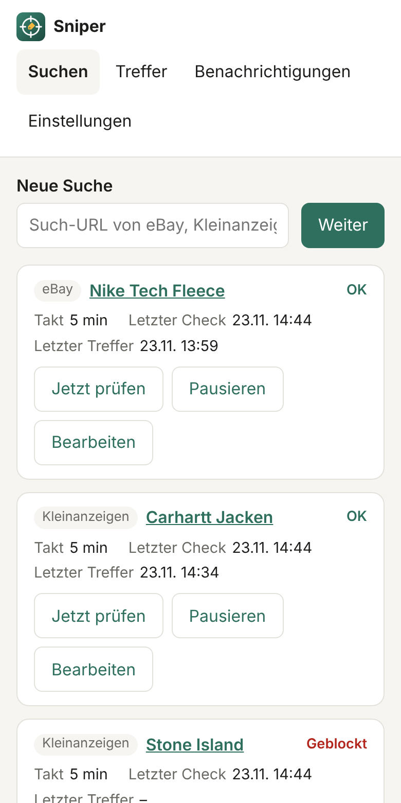
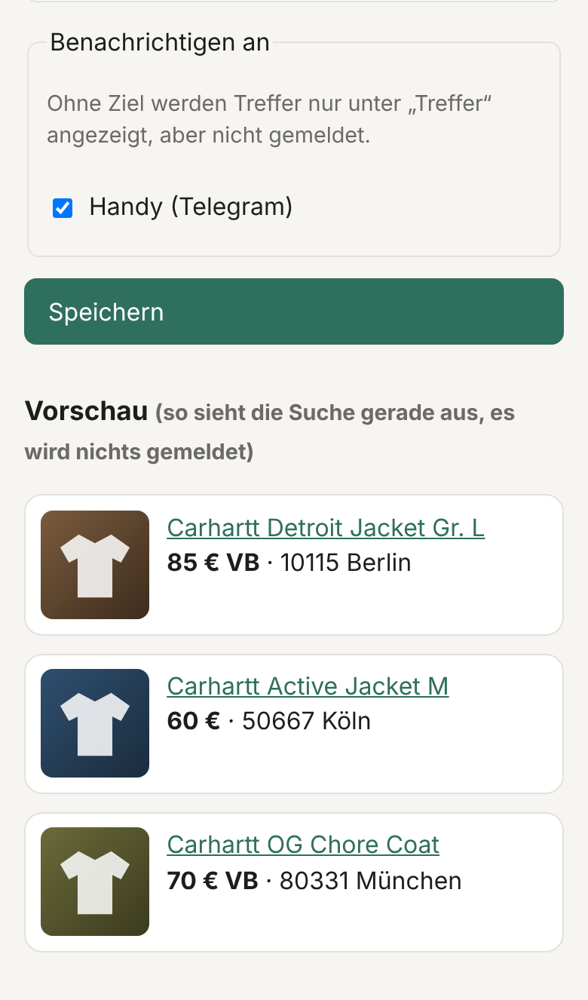
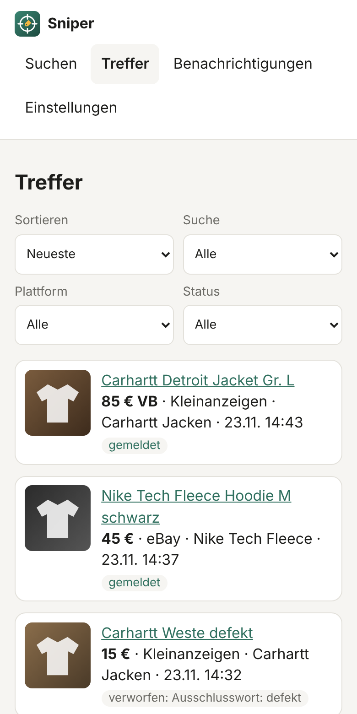

<p align="center">
  
</p>

<h1 align="center">Marktplatz-Sniper</h1>

<p align="center">
  Beobachtet deine Suchen auf <b>eBay</b>, <b>Kleinanzeigen</b> und <b>willhaben</b><br>
  und schickt neue Anzeigen mit Foto, Preis und Link sofort aufs Handy.
</p>

<p align="center">
  <a href="https://github.com/MySquat516/marktplatz-sniper/actions/workflows/ci.yml"></a>
  <a href="https://github.com/MySquat516/marktplatz-sniper/actions/workflows/docker.yml"></a>
</p>

---

Der Sniper ist für Reseller gedacht, die gute Ware früh sehen wollen, ohne ständig selbst zu suchen.
Er ergänzt den [vinted-bot](https://github.com/jasp-nerd/vinted-bot): Vinted prüft der vinted-bot
sehr oft, die übrigen Plattformen prüft der Sniper in ruhigerem Takt (Standard: alle 5 Minuten).

## Was er kann

- **Drei Plattformen:** eBay (über die offizielle API), Kleinanzeigen und willhaben
- **Suche per URL:** Du stellst die Suche auf der Plattform selbst ein (Begriff, Preis, Größe, Umkreis …)
  und fügst die URL ein. Eine Vorschau zeigt sofort, was gerade gefunden wird.
- **Nur wirklich Neues:** Der erste Check merkt sich die aktuelle Seite, danach wird jede neue Anzeige gemeldet.
  Anzeigen, die älter als 24 Stunden sind, und TOP-Anzeigen bleiben draußen.
- **Eigene Filter:** Höchstpreis und Ausschlusswörter (z. B. „defekt“) pro Suche
- **Benachrichtigungen überallhin:** Telegram, Discord, ntfy, Pushover, E-Mail, Home Assistant und
  über 100 weitere Dienste über [Apprise](https://github.com/caronc/apprise)
- **Sagt Bescheid, wenn etwas klemmt:** Statusmeldung bei einem Block, bei einer geänderten Seite und
  wenn eine Suche zu lange still ist
- **Trefferliste:** alle Funde mit Foto, sortierbar nach Datum oder Preis, filterbar nach Suche, Plattform und Status
- **Fürs Homelab gebaut:** ein Docker-Container (amd64 und arm64), SQLite, optionaler Passwortschutz,
  läuft als Web-App auch auf dem iPhone-Homescreen

## Screenshots

<table>
  <tr>
    <td align="center"><br><sub>Suchen mit Status</sub></td>
    <td align="center"><br><sub>Neue Suche mit Vorschau</sub></td>
    <td align="center"><br><sub>Treffer mit Filtern</sub></td>
  </tr>
</table>

So sieht eine Meldung in Telegram aus (mit Foto):

```text
Carhartt Detroit Jacket Gr. L
85 € VB · Kleinanzeigen
📍 10115 Berlin
🔎 Carhartt Jacken
➜ Anzeige öffnen
```

## Schnellstart

Bei jedem Push auf `main` baut GitHub ein fertiges Image:
`ghcr.io/mysquat516/marktplatz-sniper:latest`. Auf dem Server brauchst du nur die
[`docker-compose.yml`](docker-compose.yml) aus diesem Repo:

```bash
docker compose pull      # neues Image holen
docker compose up -d     # starten oder aktualisieren
```

Danach ist die Oberfläche unter `http://<server>:8092` erreichbar. Einen anderen Port wählst du beim
Start, zum Beispiel mit `PORT=8096 docker compose up -d`. Im Container läuft der Sniper immer auf 8095.

Das Image ist öffentlich, ein `docker login` ist nicht nötig.

### Erste Schritte

1. **Benachrichtigungen:** ein Ziel anlegen (z. B. Telegram, siehe unten) und **Test senden** drücken.
2. **Suchen:** die URL einer Suchergebnisseite einfügen, die Vorschau prüfen und speichern.
3. Fertig. Neue Anzeigen landen ab dem nächsten Check auf deinem Handy.

## Konfiguration

Das meiste stellst du in der Oberfläche ein. In der `docker-compose.yml` gibt es dazu unter
`environment:` ein paar Variablen:

| Variable | Standard | Wofür |
|---|---|---|
| `APP_PASSWORD` | leer | schaltet den Login ein (ohne Passwort nur im Heimnetz oder per VPN betreiben) |
| `APP_USER` | `admin` | Benutzername für den Login |
| `EBAY_CLIENT_ID` / `EBAY_CLIENT_SECRET` | leer | eBay-Zugangsdaten, alternativ unter *Einstellungen* |
| `TZ` | `Europe/Berlin` | Zeitzone für die Logs |

Alle Daten (Datenbank `sniper.db`, Probe-Dateien) liegen im Volume `./data`. Bei einem Update bleiben
Suchen, Ziele und Treffer erhalten. Die Datenbank wird beim Start automatisch angepasst.

## Benachrichtigungen

Unter **Benachrichtigungen** legst du Ziele mit einer Apprise-Adresse an. Pro Suche wählst du, an
welche Ziele sie meldet. Ziele mit **„bekommt Statusmeldungen“** erfahren außerdem, wenn eine Suche
geblockt wird, kaputtgeht oder still ist.

| Dienst | Adresse |
|---|---|
| Telegram | `tgram://BOT_TOKEN/CHAT_ID` |
| Discord | `discord://WEBHOOK_ID/WEBHOOK_TOKEN` |
| ntfy | `ntfy://THEMA` oder `ntfys://ntfy.example.com/THEMA` |
| Home Assistant | `hassio://HOST/LONG_LIVED_TOKEN` |

Alle weiteren Dienste stehen im [Apprise-Wiki](https://github.com/caronc/apprise/wiki). Bei Diensten
mit anklickbaren Links (z. B. Telegram) steht in der Meldung „Anzeige öffnen“, sonst der ganze Link.

<details>
<summary><b>Telegram-Bot einrichten</b></summary>

1. In Telegram **@BotFather** öffnen, `/newbot` schicken, einen Namen und einen Benutzernamen
   (endet auf `bot`) wählen. Am Ende bekommst du den **Token**, den du wie ein Passwort behandelst.
2. Deinen neuen Bot öffnen und auf **Starten** tippen (oder irgendeine Nachricht schicken).
3. Im Browser `https://api.telegram.org/bot<TOKEN>/getUpdates` aufrufen. Der Token kommt direkt
   hinter `bot`, ohne Schrägstrich und ohne `< >`. Bei `"chat":{"id":…}` steht deine **Chat-ID**.
4. Im Sniper als Adresse `tgram://<TOKEN>/<CHAT-ID>` eintragen und **Test senden**.

Für eine Gruppe fügst du den Bot hinzu und schreibst dort etwas. Die Gruppen-ID beginnt mit `-`.
Ein passendes Profilbild für den Bot liegt unter
[`docs/branding/telegram-bot-sniper.png`](docs/branding/telegram-bot-sniper.png)
(bei @BotFather mit `/setuserpic` setzen).

</details>

<details>
<summary><b>eBay einrichten</b></summary>

eBay läuft über die offizielle Browse API und braucht kostenlose Zugangsdaten:

1. Auf [developer.ebay.com](https://developer.ebay.com) mit deinem eBay-Konto beim Developers Program anmelden.
2. Eine Anwendung anlegen und ein **Production**-Keyset erzeugen.
3. Bei den **„Marketplace Account Deletion“-Benachrichtigungen** die **Befreiung (Exemption)** wählen.
   Begründung: Der Sniper speichert keine eBay-Nutzerdaten, nur Titel, Preis, Ort, Fotos und Link.
4. **App ID (Client ID)** und **Cert ID (Client Secret)** unter *Einstellungen* eintragen.

Das Standardlimit liegt bei 5.000 Abfragen pro Tag. Der Sniper zählt mit und erlaubt keine Einstellungen,
die hochgerechnet über 4.500 kämen. Drei eBay-Suchen alle 5 Minuten sind rund 860 Abfragen am Tag.

</details>

<details>
<summary><b>Im Homepage-Dashboard einbinden</b></summary>

```yaml
- Reselling:
    - Sniper:
        icon: http://<server>:8092/static/icon-192.png
        href: http://<server>:8092
        description: eBay, Kleinanzeigen & willhaben
        siteMonitor: http://<server>:8092/healthz
        container: marktplatz-sniper
```

</details>

## Wie der Sniper entscheidet, was neu ist

- Beim **ersten Check** einer Suche wird nichts gemeldet. Der Sniper merkt sich nur, was gerade auf der Seite steht.
- Danach ist eine Anzeige neu, wenn diese Suche sie noch nie gesehen hat. Taucht dieselbe Anzeige in
  zwei Suchen auf, meldet jede Suche sie.
- **Verworfen** werden Anzeigen, die älter als 24 Stunden sind, über dem Höchstpreis liegen oder ein
  Ausschlusswort im Titel haben. Unter **Treffer** steht jeweils der Grund.
- Pro Check gehen höchstens **10 Meldungen** raus. Gibt es mehr, kommt eine Sammelmeldung mit Link zur Suche.
- Jede Meldung wird erst gespeichert und dann verschickt. Ist ein Dienst kurz nicht erreichbar, versucht
  es der Sniper nach 1, 5, 15 und 60 Minuten erneut, insgesamt bis zu 24 Stunden lang.

## Wenn etwas nicht klappt

Jede Suche zeigt auf der Startseite ihren Zustand:

| Zustand | Bedeutung |
|---|---|
| **OK** | Alles läuft. |
| **Geblockt** | Die Seite verweigert gerade die Abfragen. Der Sniper fragt seltener (bis alle 60 Minuten) und meldet sich, wenn es wieder geht. |
| **Seite unbekannt** | Die Plattform hat ihre Seite umgebaut. Dann hilft eine Probe (siehe unten). |
| **Fehler** | Netzwerk- oder sonstiger Fehler. Nach drei Fehlschlägen in Folge kommt eine Statusmeldung. |

In den Logs siehst du, was passiert, zum Beispiel warum ein Bild nicht mitgeschickt wurde:

```bash
docker logs --since 30m marktplatz-sniper
```

Kleinanzeigen und willhaben haben keine offizielle Schnittstelle. Erkennt der Sniper eine Seite nicht
mehr, speichert eine **Probe** die echte Antwort, damit sich der Parser anpassen lässt:

```bash
docker exec marktplatz-sniper sniper probe "https://www.kleinanzeigen.de/s-jacke/k0"
```

Die Dateien landen unter `./data/probes/`.

> **Kleinanzeigen und Cloudflare:** Von einem normalen Internetanschluss klappt ein ruhiger Takt meist.
> Bei sehr kurzen Takten oder aus einem Rechenzentrum blockt Kleinanzeigen.

## Entwickeln

```bash
uv sync                                         # Abhängigkeiten installieren
uv run pytest                                   # Tests
uv run ruff check . && uv run ruff format --check .
DATA_DIR=./data uv run sniper serve             # lokal starten (Port 8095)
```

| Ordner | Inhalt |
|---|---|
| `src/sniper/platforms/` | eBay, Kleinanzeigen und willhaben: URLs lesen, Seiten abrufen und auswerten |
| `src/sniper/engine/` | Neu-Erkennung, ein Check pro Suche, Planer |
| `src/sniper/notify/` | Meldungstexte, Versand über Apprise, Outbox mit Wiederholungen |
| `src/sniper/web/` | Oberfläche (Flask) |
| `docs/superpowers/` | Design und Umsetzungsplan |

Gebaut mit Python 3.12, Flask, SQLAlchemy, curl_cffi und Apprise.

---

<sub>Diese App wurde mit Hilfe von KI (Claude von Anthropic) entwickelt. Idee und Anforderungen
kommen vom Projektinhaber, der Code wurde KI-gestützt geschrieben.</sub>
